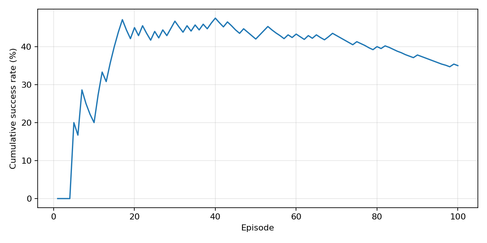

# place_a2b_left：π0 + RTC 仿真测评（2026-11-18）

## 配置与训练

- 仿真任务：RoboTwin 2.0 `place_a2b_left`，`demo_clean`，`aloha_agilex`。
- 数据：50 条演示，转换后的 LeRobot 数据集 `rtc_place_a2b_left_clean`，共 7,451 帧。
- 模型：重新从通用 π0 基础权重开始，以 JAX OpenPI 进行 LoRA 微调；训练配置 `rtc_robotwin_pi0_lora`，batch size 32，目标 30,000 步。
- 训练脚本退出码为 0。最终保存的 checkpoint 目录名是 `29999`（训练循环从 0 计数），路径为 `/workspace/RoboTwin/XPolicyLab/policy/Pi_0/checkpoints/rtc_place_a2b_left_lora_seed0/29999`；归一化资产在该目录的 `assets/rtc_place_a2b_left_clean/norm_stats.json`。本实验没有使用先前的 `adjust_bottle` checkpoint。

## 仿真结果

| 评测模式 | 成功 / 总数 | 成功率 | 设置 |
| --- | ---: | ---: | --- |
| RTC 异步动作块融合 | 35 / 100 | 35.0% | 请求间隔 8 个动作步；模型服务端口 6000 |
| 不使用 RTC 的同步 π0 | 33 / 100 | 33.0% | 同一训练 checkpoint，诊断对照 |

两组的差值是 2 个百分点。100 次测评的抽样波动较大，而且专家检查跳过了部分无效随机种子，因此不能据此断言 RTC 提高或降低了成功率。当前可确认的是异步推理与仿真联通，并生成了测评录像；该任务的成功率仍需通过成功和失败视频、动作与数据映射来排查。

另有 1 次异步冒烟测评（0/1）和 10 次同步诊断测评（4/10）；这些不计入上表的正式 100 次测评。

## 曲线

训练 loss 反映对演示数据的拟合。累计成功率是到第 n 个 episode 为止的成功数除以 n；前期幅度大，终点 35/100 = 35.0%，并不是随着训练步数下降的验证 loss。

## 精选仿真录像

以下四段均来自 **2026-11-18_01-03-18_664879** 批次的 100 次 RTC 异步测评；episode 编号对应原始 MP4。视频由本次仿真实际录制，并非原真机项目素材。

| 测评判定 | Episode | 视频 | 时长 |
| --- | ---: | --- | ---: |
| 成功 | 24 | [播放 / 下载](../assets/robotwin/rollouts/rtc_async_100/episode24.mp4) | 13.9 秒 |
| 成功 | 51 | [播放 / 下载](../assets/robotwin/place_a2b_left_rtc_success_episode51.mp4) | 12.6 秒 |
| 失败 | 0 | [播放 / 下载](../assets/robotwin/rollouts/rtc_async_100/episode0.mp4) | 40.0 秒 |
| 失败 | 1 | [播放 / 下载](../assets/robotwin/rollouts/rtc_async_100/episode1.mp4) | 40.0 秒 |

失败片段在 400 动作步上限结束；成功片段在环境报告成功时结束。画面可用于人工检查动作过程，成功率仍以原始测评统计为准。用户提供的 ZIP 中还保存了其余 episode，本仓库按要求只上传精选录像。

## 日志、CSV 和 checkpoint 路径（未上传）

- 异步日志：`/workspace/rtc_place_a2b_left_lora_seed0.eval100.log`。
- 同步对照日志：`/workspace/rtc_place_a2b_left_lora_seed0.sync100.log`。
- 训练日志：`/workspace/rtc_place_a2b_left_lora_seed0.setup.log`。
- 图和数据：`/workspace/rtc_place_a2b_left_lora_seed0_metrics/` 下的 `train_loss.png`、`train_loss.csv`、`eval_success.png`、`eval_success.csv`、`summary.json`。
- 完整原始 MP4 已由用户以 ZIP 提供；GitHub 收录本页列出的精选录像。GPU 实例上的原目录为 `/workspace/RoboTwin/eval_result/place_a2b_left/Pi_0/demo_clean/rtc_place_a2b_left_lora_seed0/`。

`train_loss.png` 仅表示**训练集 loss**；`eval_success.png` 是仿真 episode 的累计成功率。尚未生成独立验证集的 loss 曲线。两张曲线 PNG 与四段精选录像已上传。完整原始 MP4 已由用户另行提供 ZIP；曲线 CSV、训练与测评日志、大体积 checkpoint 尚未上传到 GitHub，销毁租用实例前应下载或另行备份。
